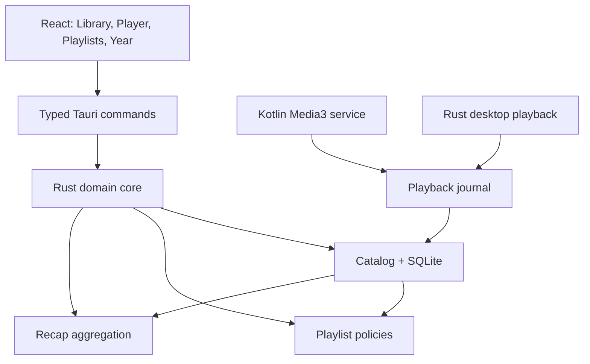

# Local Music Player + Yearly Recap — Codex Development Guide

**Status:** implementation brief, 7 October 2026  
**Target:** Android MVP, with a shared Tauri 2 desktop development shell  
**Stack:** React + TypeScript + Vite; Tauri 2; Rust; SQLite; Kotlin/Media3 on Android  
**Primary product qualities:** local files, fast response, reliable background playback, private listening history, accurate annual recap, restrained design

## 0. Instructions to the implementing Codex agent

Build a working application in small, reviewable commits. Do not stop after scaffolding, wireframes, or a desktop-only proof. The MVP is complete only after a physical Android device can import music, play with the screen locked, record listening accurately, display a year-to-date recap, play its recap playlist, and export a privacy-safe recap card. Desktop support should exercise the same Rust catalog, history, playlist, and recap logic.

Before changing a repository, inspect its `AGENTS.md`, license, current source, build scripts, tests, and status. If a repository does not exist, initialize one, commit the baseline, then implement each milestone in a focused commit. Keep React components presentational. Place domain rules in Rust. Android native code owns playback that must continue while the WebView is suspended.

Every milestone ends with a build and the relevant meaningful checks. Record actual measurements, device model, OS version, library size, and build hash. Never claim that a target is met based only on a simulator or desktop run. Use source links in §16 for architectural reference; all starter snippets below are newly written sketches, not copied code. Check licenses before importing any upstream code or asset.

## 1. Product contract and release cut

The app is a local music player with a personal recap, then progressively richer playlist intelligence. It does not require an account or network connection for the MVP.

### MVP capabilities

1. Import local audio from an Android library and selected folders; index title, artist, album, track/disc numbers, duration, artwork, URI, and supported format.
2. Browse/search songs, artists, albums, and manually created playlists.
3. Play, pause, seek, skip, shuffle, repeat, and edit a persistent queue. Continue playback with the screen locked and provide notification/headset controls.
4. Save actual playback time, qualified plays, skips, and a private/excluded-session flag in a crash-tolerant local journal.
5. Generate a year-to-date recap using that journal. Show totals, top song, top artist, top album, listening months, and a playable recap playlist.
6. Export a frozen annual or year-to-date recap snapshot and a share-safe portrait card.
7. Generate a basic local smart playlist from explicit filters such as genres, favourite artists, duration, and exclusions. The controls should be visible and editable.
8. Provide English and Spanish UI strings for the primary journey, without requiring a language model.

### After the MVP

- Knowledge-card enrichment from MusicBrainz and TheAudioDB, confidence scoring, optional source fallback, and text embeddings.
- Natural-language intent parsing with a small on-device model; optional remote distillation and curation through a replaceable backend.
- Taste Orbit, rediscovery stories, richer album metrics, crossfade, ReplayGain, Android Auto, iOS, and advanced format handling after platform tests.

Do not imply that a metadata-filtered playlist is semantically understood by AI. Label the MVP control **Generate playlist**; expose its filters. The semantic assistant becomes a first-class entry in the same screen when its catalog-backed retrieval is ready.

## 2. Decisions carried forward from the Music Playlist AI Design conversation

- Keep **Tauri 2 + React/TypeScript/Vite + Rust**. Test the shared UI and domain core on desktop and Android. The previous Android-only Kotlin/Compose recommendation is superseded.
- Keep TagLib as a metadata candidate, SQLite as the durable store, and a background semantic enrichment module detached from playback. Android MediaStore is the first discovery interface; a granted content URI is not necessarily a normal filesystem path that TagLib can open. Add a metadata adapter instead of forcing path conversion.
- Keep the semantic philosophy: descriptive text about songs supports requests such as “melancholic but not depressing.” Audio-waveform analysis and `bliss-rs` are outside the initial release by explicit prior decision.
- Keep a MiniLM/E5-class **text** embedding interface, optional `sqlite-vec`, hard filters, soft preferences, and deterministic sequencing for the later semantic version. Query embeddings are ephemeral; song-card embeddings are persisted and versioned.
- Keep versioned TOON contracts only at an LLM boundary, with strict validation. Rust structs and typed Tauri commands are the internal contracts. GPT4Free is a replaceable experimental remote backend, not an embedded service or a generic custom MCP client.
- Exclude Wikipedia from the default enrichment sources per the earlier decision. The original confidence score gates extra retrieval; it does not certify an LLM's statements.
- Preserve three modes: fully enriched online, enriched offline, and cold-start offline. The MVP starts in the third mode and must still play music and generate honest metadata-based playlists.
- The new recap and Android performance requirements move the event ledger and native playback plugin ahead of semantic enrichment in the implementation order.

## 3. Architecture and ownership



The audio service is the authority for playback state. The WebView subscribes to snapshots and changes; it must never be the only owner of the clock, queue, or listening events. The Android plugin either persists journal checkpoints through a Rust bridge independent of the WebView or uses an on-device pending journal that Rust imports idempotently. Prove that boundary in milestone 0.

### Suggested repository layout

```text
music-player/
  README.md
  LICENSE
  docs/
    architecture.md
    recap-methodology.md
    performance-results.md
    licenses.md
  src/
    app/App.tsx
    app/routes.tsx
    api/commands.ts
    api/types.ts
    components/MiniPlayer.tsx
    components/TrackRow.tsx
    features/library/
    features/player/
    features/playlists/
    features/recap/
    design/tokens.css
    design/components.css
    i18n/en.ts
    i18n/es.ts
  src-tauri/
    src/lib.rs
    src/commands/
    src/catalog/
    src/metadata/
    src/playback/{mod.rs,desktop.rs,android.rs}
    src/history/{mod.rs,accumulator.rs,repository.rs}
    src/playlist/{mod.rs,filter.rs,rank.rs}
    src/recap/{mod.rs,aggregate.rs,snapshot.rs}
    src/storage/
    migrations/
    plugins/android-playback/
    plugins/android-library/
  tests/fixtures/
```

### Module contracts

| Owner | Inputs | Outputs | Never owns |
| --- | --- | --- | --- |
| Catalog | MediaStore rows, selected URIs, desktop paths | Track identities, metadata, browse pages | Playback state |
| Artwork | Embedded image bytes or stable track/album identity | Sized cover thumbnails or deterministic fallback covers | Audio playback, remote image generation |
| Playback | Track ID, queue command, resolved URI | State snapshot, transitions, audible progress | Recap calculations |
| History | Native playback transitions, active intervals | Idempotent session/interval journal | UI timers |
| Playlist | Typed request, catalog, optional taste signals | Validated track IDs and ordering | Arbitrary model-generated SQL |
| Recap | Listening intervals, sessions, catalog snapshot, year/zone | Frozen statistics and playlist IDs | Audio decoding or LLM calls |
| UI | Typed snapshots and user actions | Accessible views, share artwork | Source of truth for music listened |

Use stable opaque `TrackId`/`SessionId` values. A path or MediaStore ID may change. Preserve remaster and live-edition identities even when titles coincide. Initially reconcile using granted URI, size, duration, normalized metadata, and an optional file hash; avoid hashing an entire library on the critical import path.

## 4. Data model and recap semantics

Store timestamps as UTC, plus the selected IANA time zone used to present a recap. Store monotonic played durations from the native playback process; wall-clock changes must not add listening minutes. The event journal and interval table are the evidence; materialized totals are caches.

### Baseline schema sketch (`src-tauri/migrations/0001_initial.sql`)

```sql
PRAGMA foreign_keys = ON;

CREATE TABLE tracks (
  id TEXT PRIMARY KEY,
  source_uri TEXT NOT NULL,
  source_kind TEXT NOT NULL,
  title TEXT NOT NULL,
  artist TEXT NOT NULL DEFAULT '',
  album TEXT NOT NULL DEFAULT '',
  album_artist TEXT NOT NULL DEFAULT '',
  disc_no INTEGER,
  track_no INTEGER,
  duration_ms INTEGER NOT NULL CHECK (duration_ms >= 0),
  genre TEXT,
  release_year INTEGER,
  artwork_key TEXT,
  file_size INTEGER,
  source_modified_utc TEXT,
  available INTEGER NOT NULL DEFAULT 1 CHECK (available IN (0,1))
);

CREATE TABLE playlists (
  id TEXT PRIMARY KEY,
  title TEXT NOT NULL,
  kind TEXT NOT NULL CHECK (kind IN ('manual','generated','recap')),
  created_at_utc TEXT NOT NULL
);
CREATE TABLE playlist_items (
  playlist_id TEXT NOT NULL REFERENCES playlists(id) ON DELETE CASCADE,
  position INTEGER NOT NULL,
  track_id TEXT NOT NULL REFERENCES tracks(id),
  PRIMARY KEY (playlist_id, position)
);

CREATE TABLE listening_sessions (
  id TEXT PRIMARY KEY,
  track_id TEXT NOT NULL REFERENCES tracks(id),
  started_at_utc TEXT NOT NULL,
  ended_at_utc TEXT,
  last_checkpoint_utc TEXT NOT NULL,
  played_ms INTEGER NOT NULL DEFAULT 0 CHECK (played_ms >= 0),
  end_reason TEXT,
  excluded_from_recap INTEGER NOT NULL DEFAULT 0
    CHECK (excluded_from_recap IN (0,1)),
  origin TEXT NOT NULL DEFAULT 'manual'
);

CREATE TABLE play_intervals (
  session_id TEXT NOT NULL REFERENCES listening_sessions(id),
  sequence_no INTEGER NOT NULL,
  start_utc TEXT NOT NULL,
  end_utc TEXT NOT NULL,
  played_ms INTEGER NOT NULL CHECK (played_ms >= 0),
  PRIMARY KEY (session_id, sequence_no)
);

CREATE TABLE recap_snapshots (
  id TEXT PRIMARY KEY,
  calendar_year INTEGER NOT NULL,
  time_zone TEXT NOT NULL,
  schema_version INTEGER NOT NULL,
  generated_at_utc TEXT NOT NULL,
  covered_through_utc TEXT NOT NULL,
  complete_year INTEGER NOT NULL CHECK (complete_year IN (0,1)),
  metrics_json TEXT NOT NULL,
  track_ids_json TEXT NOT NULL,
  display_metadata_json TEXT NOT NULL,
  visual_seed TEXT NOT NULL
);

CREATE INDEX idx_tracks_artist_album ON tracks(artist, album);
CREATE INDEX idx_sessions_start ON listening_sessions(started_at_utc);
CREATE INDEX idx_sessions_track ON listening_sessions(track_id);
CREATE INDEX idx_intervals_time ON play_intervals(start_utc, end_utc);
```

Use an FTS5 virtual table for title/artist/album search and update it transactionally when tracks change. Add migrations for reconciliation aliases and source provenance when semantic indexing begins. Use WAL, prepared statements, bounded transactions, and a single clear writer policy. Do not enable extensions by default just to store 384-dimensional vectors for a modest library.

### Event rules, documented for users

1. Start a new session when a track actually begins playback. Pause/resume stays in the same session. Seeking does not start a new session. A replay caused by returning to the track starts another session.
2. Each interval records time **actually playing**, checkpointed about every ten seconds and at pause, seek, transition, service termination, and queue replacement. A crash loses at most the uncheckpointed interval; replayed checkpoint messages are idempotent through `(session_id, sequence_no)`.
3. A qualified play requires at least **30 seconds** accumulated in a session. This is a transparent initial product rule, inspired by Spotify's published Wrapped methodology; do not present it as a universal industry rule.
4. Listening minutes include shorter sessions, based on actual playing time. Buffering, paused time, and stopped time contribute zero.
5. Assign a qualified play to the local calendar year in which the session started. Split intervals crossing a local midnight/year boundary for listening-time totals. Store the year and zone in the recap snapshot.
6. Top songs: number of qualified plays, then played milliseconds, then stable track ID for deterministic ties. Top artists: aggregate qualified song plays by canonical artist. Top album: qualified plays across tracks linked to the same album/album artist. Explain that remasters remain separate tracks until the identity policy is more mature.
7. Do not include excluded sessions in ranking cards or share outputs; offer a toggle for whether they contribute to aggregate time, and document its default. MVP default: excluded sessions contribute to neither ranking nor time.
8. The first year begins on the date history collection was enabled. Show **“Since [date]”** prominently; never fabricate January through installation-date listening.

The recap method must be implemented as versioned Rust functions with fixture tests, not as incidental UI query code. A year-to-date preview is recalculated; a saved snapshot freezes the metrics, display names, playlist IDs, and visual seed. If a file is removed, preserve its snapshot label and show an unavailable item when the recap playlist is opened.

## 5. Recap story and export

The first story should contain six scenes and a final action:

| Scene | Calculation | Display |
| --- | --- | --- |
| Opening | year, coverage date, deterministic seed | Static poster, small restrained motion optional |
| Listening time | sum included interval duration | Minutes and active days |
| Top track | ranked qualified plays | Cover, title, count |
| Top artist and album | grouped qualified plays | Two clean rows with counts |
| The year by month | split playback intervals in chosen zone | 12-column chart; unobserved months marked as such |
| Year in Tracks | top tracks with artist cap and stable order | Play/save playlist, unavailable markers |
| Export | snapshot and card | JSON snapshot, PNG portrait card, selective share |

The generated playlist should include up to 25 distinct playable tracks, max two per primary artist by default; relax that cap if fewer than ten tracks are available. Rank first by qualified plays, then time. Keep output deterministic. Do not insert tracks the user never played into the recap playlist. Additional “rediscovery” or semantic stories need separate evidence rules and belong after the MVP.

For the PNG, target 1080×1920 pixels and a safe preview inside the app. Include only display title/artist, artwork that the app may lawfully render for personal sharing, rounded metrics, and generated graphics. Exclude file paths, exact timestamps, device identity, private playlist names, lyrics, and provider tokens. Export must work offline.

## 6. Playlist request feature in the MVP

Provide one form with target track count or duration, genre, liked songs preference, artist include/exclude, and “avoid heard today.” A seed-song radio shortcut may use matching artist/genre in the MVP. This is deliberately inspectable. A `PlaylistRequest` is parsed/validated before any query; SQL uses parameters. Retrieve a pool, apply exclusions first, score remaining tracks, then select with per-artist limits and duration budget. Never send candidate IDs not present in the catalog to playback.

Later, a local model may translate English/Spanish into this same type. An embedding model and knowledge cards expand retrieval while preserving the typed request and deterministic filters. Only call the interface `AI Playlist` once testing shows it understands meaning beyond basic tags.

## 7. Performance: the app must feel immediate

These are **initial release gates**, to be measured on a representative low/mid Android phone (4–6 GB RAM), a current phone, and one development desktop using libraries of 100, 2,000, and 10,000 tracks. Adjust numerical budgets only with recorded profiling evidence. Use release builds and repeat each scenario after a warm-up.

| Interaction | Initial target / test |
| --- | --- |
| Warm launch to usable library | p95 ≤ 800 ms with cached catalog; no full rescan on launch |
| Cold launch to usable shell | p95 ≤ 2.5 s on mid-range device; scan continues incrementally |
| Tap local song to audible output | p95 ≤ 500 ms after URI access is already granted |
| Play/pause feedback | visible state within 100 ms; native command result reconciles state |
| Search 10k indexed tracks | p95 ≤ 100 ms after typing debounce; query is paged |
| Scroll library/player | no sustained dropped-frame cluster; aim 60 fps on target device |
| Recap generation at 100k intervals | ≤ 1 s p95 without blocking the UI thread |
| Locked-screen playback | 60 minutes without audio interruption or missed journal checkpoints |
| Idle background | WebView animation, analysis, and polling suspended; compare battery and memory with a native local player under the same conditions |

Specific implementation rules:

- Virtualize long lists and fetch 50–100 rows at a time. Use FTS5 for text search; do not fetch the full catalog into React.
- Generate bounded artwork thumbnails during import, cache them by artwork key, and keep the full-resolution source out of track-row rendering. Decode only visible covers.
- If a track has no usable embedded image, render a cached procedural cover from its stable identity. Generate off the UI thread with bounded CPU/memory, and never regenerate it during list scrolling. Prefer a small static thumbnail in rows; load the larger version only in the full player.
- Render progress locally from the last native snapshot and elapsed time; do not send high-frequency Tauri IPC on every animation frame. Correct drift on periodic native updates and transitions.
- Give playback the highest priority. Scan metadata on a bounded worker queue (start with one or two concurrent files); do not run LLM inference or batch enrichment while playback is starting. Pause or throttle indexing under battery saver or thermal pressure.
- Use transactions for batches, prepared SQL, appropriate indexes, and a single recap aggregation job per year. Memoize year-to-date output until new intervals arrive.
- Keep the default player static. Optional procedural graphics are lazy-loaded, stop rendering when hidden, and respect reduced-motion and battery-saver settings. Avoid GPU filters, large blurs, or constant full-screen canvas repaints.
- Measure release APK/AAB size, process RSS/PSS, CPU, frame time, battery consumed in a fixed one-hour playlist, database growth, and peak scan memory. Store results in `docs/performance-results.md` with device/build details; optimize the measured bottleneck.

Do not make the target table a marketing claim. The first device spike can reveal that the Tauri WebView startup budget is too aggressive; report the measured number and fix the largest source of delay before loosening a gate.

## 8. Interface specification: Samsung Music restraint, distinct identity

Samsung Music's useful interaction model is library sections, a persistent mini-player, and a full player with immediate queue/favourite controls. Apply One UI's clear hierarchy and reachable navigation as principles, while drawing original icons/layout details and retaining the project's identity.

### Mobile information architecture

```text
Library   Playlists   Your Year
            [persistent mini-player]
            [bottom navigation]
```

- **Library:** large but quiet heading, search, Songs/Albums/Artists controls, rows with small artwork and two text lines. Opening an album starts from a simple list, without stacked recommendation carousels.
- **Full player:** square cover, generous negative space, title and artist, progress/time, previous/play/next, a restrained row for favourite, queue, repeat and shuffle. The queue opens as a sheet; dragging order must remain clear.
- **Playlists:** manual playlists and one prominent `Generate` action; generator presents concrete constraints. The eventual natural-language entry fits here, beside the controls it can populate.
- **Your Year:** quiet cover with the current coverage range and `View recap`; card flow has a consistent close/back action, no mandatory motion, and a replayable playlist at the end.
- **Desktop:** same components in a responsive two-column layout, keyboard shortcuts, persistent bottom transport.

### Design tokens

- Base surfaces: near-white and deep charcoal with sufficient contrast; use one restrained artwork-derived accent for active states.
- Typography: Space Grotesk for a small number of prominent titles and Inter/system fallback for song rows and controls. Keep title size responsive and never let a long track title displace transport controls.
- Separation: fine rules and spacing rather than many cards. Icons are consistent; active state is not indicated by colour alone.
- Animation: 120–220 ms transforms/opacity for navigation and state; no permanent page-wide motion.
- The Origin of Symmetry Lorenz field is an **optional** player visual or a quiet recap poster motif. Keep its parameters fixed and use a deterministic seed. It must not be presented as an acoustic measurement. The default is album artwork.
- **Missing-cover visual language:** draw an original geometric abstract composition inspired by the balance, circles, lines, and colour interplay of Kandinsky, with a modern minimal treatment. Limit shapes and palette so it remains legible at 48 px. Embedded album art always wins by default; the generated cover is a considered fallback, not an automatic replacement for an artist's artwork. Offer a user option to prefer generated covers later only if useful.
- Support touch targets of at least 44 CSS pixels, system text scaling, screen-reader labels, reduced motion, dark mode, and small/large phones.

Do not clone Samsung's assets, trade dress, exact layout, iconography, or branding. Use the product principles, then make this app recognizably its own.

### Procedural cover fallback (MVP)

Add `src-tauri/src/artwork/{mod.rs,extract.rs,procedural.rs,cache.rs}` with a clear `resolveCover(trackId, size)` command boundary. First validate embedded artwork; on absence, corruption, or decode failure, use the procedural renderer. A generic placeholder is the last-resort fallback if rendering also fails. When many tracks belong to the same album, use a stable album key so their fallback cover is shared; use a stable track key for singles or unidentified albums. Do not seed from row position, a transient MediaStore ID, absolute file path, or the current time.

The renderer uses a fixed algorithm version and a seeded PRNG to choose a restrained composition: one or two circles/arcs, a few thin lines and rectangles, carefully controlled negative space, and a limited palette anchored by charcoal, warm cream, orange `#ff6600`, and occasional muted blue. Build original shapes; do not reproduce a specific painting. Ensure thumbnail contrast in both themes. The seed can be `hash("cover-v1" || stableAlbumOrTrackKey)`; changing the algorithm increments its version. Store `cover-v1/<seed>/<size>` in a bounded disk cache, with separate sizes around 64 px (rows) and 512–768 px (player). Generate and encode outside the render path; precompute during incremental import when idle or on first request, then cache. Invalidate on embedded-art change, identity reconciliation, or renderer-version change. Keep the fallback stable across app restarts and offline use.

The generated image is **static**. Do not invoke an LLM, a diffusion model, a network image service, or an always-running canvas to fill missing covers. Any optional Lorenz animation in the full player remains a separate visualizer, starts only when selected, and stops when hidden. The recap exporter may reuse a static motif but must derive its seed from the frozen recap snapshot rather than a track's cover seed.

Acceptance checks: two imports of the same track produce visually identical pixels at the same renderer version; tracks on the same album share a cover; corrupt artwork falls back without blocking playback; 10,000 missing-art rows scroll smoothly because only visible cached thumbnails decode; player-size rendering never delays the first audible frame. Include a small golden-image fixture or stable hash check for the renderer and profile import/cache size on the mid-range Android test device.

## 9. Original starter snippets for the codebase

These are design sketches to place in the proposed modules and complete against the selected dependency versions. They are original examples informed by the repository patterns in §16, not verbatim extracts. Keep method names in camelCase at the TypeScript/Kotlin boundary and use idiomatic snake_case in Rust.

### 9.1 Playback contract in Rust

Adapt the desktop implementation independently from the Android Media3 plugin. The command layer owns one `Arc<dyn PlaybackPort>`; React sees a snapshot rather than manipulating a decoder. This resembles the separation of player, scanner and commands documented in JMusic.

```rust
// src-tauri/src/playback/mod.rs
use async_trait::async_trait;
use serde::{Deserialize, Serialize};

#[derive(Clone, Serialize, Deserialize)]
#[serde(rename_all = "camelCase")]
pub struct PlaybackSnapshot {
    pub track_id: Option<String>,
    pub playing: bool,
    pub position_ms: u64,
    pub duration_ms: u64,
    pub queue: Vec<String>,
}

#[async_trait]
pub trait PlaybackPort: Send + Sync {
    async fn play_track(&self, track_id: &str) -> anyhow::Result<()>;
    async fn pause(&self) -> anyhow::Result<()>;
    async fn resume(&self) -> anyhow::Result<()>;
    async fn seek(&self, position_ms: u64) -> anyhow::Result<()>;
    async fn snapshot(&self) -> anyhow::Result<PlaybackSnapshot>;
}
```

An Android `PlaybackPort` can communicate with a Tauri mobile plugin. It must not block the audio thread on an IPC round-trip or on SQLite. The player service issues ordered, idempotent journal messages to a bounded persistence worker.

### 9.2 Android service skeleton

Media3's official demo uses a `MediaSessionService`/`MediaLibraryService` with ExoPlayer. The following sketch shows the ownership boundary; implement `PlaybackJournal` separately and add service declaration, foreground playback permission, session controller, audio focus, and error handling from the current Media3 guidance.

```kotlin
// src-tauri/plugins/android-playback/.../PlaybackService.kt
class PlaybackService : MediaSessionService() {
    private lateinit var player: ExoPlayer
    private lateinit var session: MediaSession
    private lateinit var journal: PlaybackJournal

    override fun onCreate() {
        super.onCreate()
        journal = PlaybackJournal.open(applicationContext)
        player = ExoPlayer.Builder(this).build()
        session = MediaSession.Builder(this, player).build()

        player.addListener(object : Player.Listener {
            override fun onMediaItemTransition(item: MediaItem?, reason: Int) {
                journal.finishPreviousAndStart(item?.mediaId)
            }

            override fun onIsPlayingChanged(isPlaying: Boolean) {
                journal.setPlaying(isPlaying)
            }
        })
        journal.startPeriodicCheckpoints(player) // while service exists, not UI timer
    }

    override fun onGetSession(
        controllerInfo: MediaSession.ControllerInfo
    ): MediaSession = session

    override fun onDestroy() {
        journal.flushAndClose()
        session.release()
        player.release()
        super.onDestroy()
    }
}
```

`PlaybackJournal` is intentionally an interface here; an implementing agent must select and test its crash-tolerant Rust/native storage bridge. A transition callback can fire for more than a user-initiated next-track action, so correlate the actual media ID and session state to avoid duplicate sessions. The Android service remains alive across app navigation and WebView suspension.

### 9.3 Monotonic playback-time accumulator

The service calls `set_playing` on transitions and `checkpoint` about every ten seconds. Persist the absolute `played_ms` and a strictly increasing interval sequence in one transaction. Repeated messages replace or ignore the same sequence, rather than adding its duration twice.

```rust
// src-tauri/src/history/accumulator.rs
use std::time::{Duration, Instant};

pub struct TimeAccumulator {
    last_tick: Instant,
    playing: bool,
    played: Duration,
}

impl TimeAccumulator {
    pub fn new(now: Instant) -> Self {
        Self { last_tick: now, playing: false, played: Duration::ZERO }
    }

    pub fn set_playing(&mut self, now: Instant, playing: bool) {
        self.advance(now);
        self.playing = playing;
    }

    pub fn checkpoint(&mut self, now: Instant) -> u64 {
        self.advance(now);
        self.played.as_millis().min(u64::MAX as u128) as u64
    }

    fn advance(&mut self, now: Instant) {
        if self.playing {
            self.played += now.saturating_duration_since(self.last_tick);
        }
        self.last_tick = now;
    }
}
```

The event source must explicitly mark buffering and audio-focus suspension as **not playing**. A seek checkpoints the current interval but does not add the skipped audio position. Use UTC wall-clock boundaries only for calendar placement, never to estimate listened time.

### 9.4 Typed Tauri calls from React

Use one command wrapper with explicit request/response types and one event subscription per mounted player context. This follows the thin frontend/command split seen in Tauri music-player repositories.

```ts
// src/api/commands.ts
import { invoke } from '@tauri-apps/api/core';

export interface TrackSummary {
  id: string;
  title: string;
  artist: string;
  album: string;
  artworkUrl?: string;
}

export interface RecapSummary {
  year: number;
  coveredFrom: string;
  coveredThrough: string;
  completeYear: boolean;
  listenedMs: number;
  qualifiedPlays: number;
  topTrack?: TrackSummary;
}

export const musicApi = {
  listTracks: (offset: number, limit = 60) =>
    invoke<TrackSummary[]>('list_tracks', { offset, limit }),
  playTrack: (trackId: string) =>
    invoke<void>('play_track', { trackId }),
  getRecap: (year: number) =>
    invoke<RecapSummary>('get_recap', { year }),
};
```

Track rows should render from a paged query; player state comes from a separate native snapshot/event stream. `getRecap` should return a cached aggregate until new intervals are committed.

### 9.5 A deterministic recap query and reducer

Compute the start and end of the user's local year in Rust, then convert those boundaries to UTC. Query qualified sessions by start time, and split interval time by overlap with the range. The SQL below is the top-track count; apply the excluded-session policy consistently to every metric.

```sql
-- named parameters :year_start_utc and :next_year_start_utc
SELECT s.track_id,
       COUNT(*) AS qualified_plays,
       SUM(s.played_ms) AS played_ms
FROM listening_sessions AS s
WHERE s.started_at_utc >= :year_start_utc
  AND s.started_at_utc < :next_year_start_utc
  AND s.excluded_from_recap = 0
  AND s.played_ms >= 30000
GROUP BY s.track_id
ORDER BY qualified_plays DESC, played_ms DESC, s.track_id ASC;
```

For minutes and monthly bars, fetch `play_intervals` overlapping the UTC range and allocate `played_ms` proportionally across each local boundary using the overlap fraction. Cover with fixtures for midnight, New Year's Eve, daylight-saving changes, pause/resume, and a clock adjustment. The source timestamps are for placement; the persisted monotonic `played_ms` is the amount.

### 9.6 Minimal playlist ranking

Build a pool with parameterized catalog queries, then filter and rank in Rust. Never let a model send SQL to SQLite. This sketch illustrates stable output and hard exclusions; add duration and artist spacing tests before exposing `Generate`.

```rust
// src-tauri/src/playlist/rank.rs
pub struct PlaylistRequest {
    pub excluded_artist_ids: Vec<String>,
    pub preferred_artist_ids: Vec<String>,
    pub max_tracks: usize,
    pub avoid_heard_today: bool,
}

pub struct Candidate {
    pub track_id: String,
    pub artist_id: String,
    pub base_score: f32,
    pub available: bool,
}

pub fn choose(request: &PlaylistRequest, mut candidates: Vec<Candidate>) -> Vec<String> {
    candidates.retain(|c| c.available
        && !request.excluded_artist_ids.contains(&c.artist_id));
    candidates.sort_by(|a, b| b.base_score.total_cmp(&a.base_score)
        .then_with(|| a.track_id.cmp(&b.track_id)));

    let mut artist_counts = std::collections::HashMap::new();
    candidates.into_iter()
        .filter(|c| {
            let count = artist_counts.entry(c.artist_id.clone()).or_insert(0usize);
            if *count >= 2 { return false; }
            *count += 1;
            true
        })
        .take(request.max_tracks)
        .map(|c| c.track_id)
        .collect()
}
```

Before calling `choose`, compute the score from matching tags, explicit favourites, and the user's requested boosts; enforce `avoid_heard_today` against recorded sessions. The final production function must handle too-small candidate pools and duration budgets without silently violating hard exclusions.

### 9.7 Low-cost UI tokens

These tokens evoke restrained spacing and clear hierarchy without copying Samsung Music's visual assets. The recap poster may add one deterministic orange/blue motif from Origin of Symmetry, while the player defaults to a quiet artwork surface.

```css
/* src/design/tokens.css */
:root {
  color-scheme: light;
  --surface: #fafafa;
  --surface-raised: #fff;
  --ink: #171717;
  --muted: #656565;
  --rule: #dedede;
  --accent: #ff6600;
  --touch: 44px;
  --space-1: 4px;
  --space-2: 8px;
  --space-3: 12px;
  --space-4: 16px;
  --space-6: 24px;
  --space-8: 32px;
}

[data-theme='dark'] {
  color-scheme: dark;
  --surface: #101010;
  --surface-raised: #1a1a1a;
  --ink: #f5f5f5;
  --muted: #aaa;
  --rule: #343434;
}

.miniPlayer {
  position: fixed;
  inset-inline: 0;
  bottom: calc(var(--bottom-nav-height) + env(safe-area-inset-bottom));
  min-height: 64px;
  display: grid;
  grid-template-columns: 48px minmax(0, 1fr) var(--touch);
  align-items: center;
  gap: var(--space-3);
  padding: var(--space-2) var(--space-4);
  background: var(--surface-raised);
  border-top: 1px solid var(--rule);
}

@media (prefers-reduced-motion: reduce) {
  *, *::before, *::after { animation-duration: 0.01ms !important; }
}
```

Reserve the mini-player and navigation heights in the scroll container so the last library row remains visible. The default `--accent` is a fallback; if artwork-derived colour is used, contrast-test it and fall back when it reduces readability.

## 10. Model and semantic pipeline after the release gate

The model update changes the evaluation roster, not the recap architecture:

| Role | Candidate | Why and condition |
| --- | --- | --- |
| English/Spanish text embedding | `multilingual-e5-small` or multilingual MiniLM, ONNX | Compare retrieval quality, model+tokenizer size, peak RAM, p95 query latency; version every stored vector |
| Local typed intent | FunctionGemma 270M | Purpose-built function calling; task-specific fine-tuning required for reliable operation |
| Alternative local intent | Qwen3.5 0.8B | Apache-2.0, broad multilingual capability; test constrained output and mobile footprint |
| Existing small-model hypothesis | Falcon-H1-Tiny 100M/0.6B | Include in actual-device comparison; the earlier ARM A76 result does not transfer automatically to Android Tauri |
| Enhanced long-form assistant | Gemma 4 E2B or remote model | Optional high-end download; keep off the baseline install |

Benchmarks: at least 200 held-out English/Spanish and code-switched playlist requests, with artist exclusions, boosts, counts, durations, negation, ambiguity, and unsupported operations. Measure exact schema validity, correct hard constraints, out-of-catalog IDs, time to first token, total response time, peak PSS, battery over repeated requests, and model download size on each device. A provisional release gate for local parsing is ≥95% valid typed outputs, 100% app-side rejection/repair of invalid hard constraints, and a p95 perceived response under two seconds on the target mid-range device. A small model is not assumed to pass without fine-tuning.

Keep these Rust traits ready but do not load a model on launch:

```rust
pub trait IntentParser {
    fn parse(&self, text: &str) -> anyhow::Result<ValidatedPlaylistIntent>;
}
pub trait SongEncoder {
    fn model_version(&self) -> &str;
    fn embed(&self, text: &str) -> anyhow::Result<Vec<f32>>;
}
pub trait CandidateRetriever {
    fn nearest(&self, query: &[f32], limit: usize) -> anyhow::Result<Vec<TrackId>>;
}
```

When enrichment arrives: metadata → deterministic source adapters → normalized evidence with provenance → completeness threshold → optional search fallback → TOON batch distillation → strictly validated canonical card → text embedding → local vector index. An on-demand user query follows intent parser → query planner → query embedding → candidate retrieval → hard filters → rank/sequence → optional curator. The model never selects nonexistent IDs or executes playback commands. A brute-force vector search in Rust is the initial fallback; enable sqlite-vec only after a device integration benchmark.

## 11. Build sequence and incremental commit plan

Create a new repository only if there is no existing project repo. Keep commits small enough that each could be reviewed or reverted. Suggested sequence and gates:

| Commit / milestone | Work | Required demonstration |
| --- | --- | --- |
| `chore: initialize Tauri React Rust workspace` | Strict TypeScript, formatting, Rust workspace, basic CI, license and architecture note | Desktop and Android shell build; no fake player |
| `feat(android): prove background playback service` | Media3 service, session, bridge, play/pause/seek and notification | 30-minute locked-screen test with UI process suspended and resumed |
| `feat(catalog): import and browse local music` | MediaStore adapter, desktop folder scanner, metadata normalization, IDs, FTS5 | 2,000-track import, cancel/resume, no duplicate rows |
| `feat(artwork): add deterministic missing-cover art` | Embedded-art validation, seeded geometric renderer, bounded thumbnail/player cache | Stable artwork after restart; corrupt/missing cover fallback; smooth long-list scroll |
| `feat(player): persistent queue and mini-player` | Queue model, native snapshots, full player, shuffle/repeat | Restart app and restore queue/position; headset controls |
| `feat(history): persist listening sessions` | Journal, checkpoint worker, exclusion flag, migration | Pause/seek/skip/crash fixtures and Android service trace |
| `feat(recap): calculate annual metrics` | Year/time-zone boundaries, qualification, totals, top lists, months | Golden-fixture output, leap year/DST/year-crossing checks |
| `feat(recap-ui): render and export story` | Six scenes, recap playlist, snapshot, PNG/JSON | Deterministic re-open/export; no private fields in PNG |
| `feat(playlists): generate local smart playlists` | Typed form, hard constraints, ranking, artist cap | Excluded artist never selected; playable output offline |
| `perf: profile and tune Android release` | Startup, search, artwork, background CPU/battery, accessibility | Recorded device matrix and release thresholds |

Do not combine the UI screens and all back-end modules in a single commit. If Android playback proves infeasible with the current Tauri integration, record exactly which capability fails and revise the native plugin boundary before building the recap UI. The shared Rust core and frontend remain useful.

### Device test matrix

- At least one physical mid-range Android phone with 4–6 GB RAM, one newer phone, and one desktop OS.
- Libraries: empty; 100; 2,000; 10,000 tracks. Include malformed tags, Unicode titles, two albums with the same name, duplicate files, remasters, missing artwork, an SD-card/folder move, and a track with unknown duration.
- Audio route changes: speaker → Bluetooth → wired if available; incoming notification/audio-focus interruption; headset media button; screen lock/unlock; app swipe-away and restart.
- Date fixtures: February 29, year boundary, DST change, private/excluded session, a session under 30 seconds, and a track played twice around midnight.
- Offline: airplane mode from launch, during scan, and while viewing/exporting recap. All MVP features must work.

## 12. Meaningful verification

Use the smallest test set that detects real regressions. The central logic warrants tests because a recap error cannot be corrected by appearance inspection.

### Core tests

- **History accumulator:** pause and buffering stop increments; seek never adds skipped duration; duplicate checkpoint is idempotent; restart resumes from last persisted checkpoint.
- **Recap golden fixture:** a hand-calculated set of sessions produces exact minutes, counts, top order, monthly distribution and exclusions. Repeat on two time zones and across a year boundary.
- **Playlist policies:** hard exclusions, duration, unavailable files and artist caps are always honoured. Deterministic input produces identical output.
- **Catalog:** moved-file reconciliation preserves track history; remaster remains distinct; reimport does not create a duplicate.
- **Export:** parse saved JSON against the snapshot schema; assert the PNG rendering data has no source URI, exact timestamp, private playlist name, or lyrics.

### Integration checks

- Verify Kotlin service ↔ Rust journal calls with a phone locked for at least 30 minutes; compare the event ledger against a manually logged timeline.
- Exercise a corrupted artwork/tag and a removed SD card without terminating the player or corrupting SQLite.
- On a fresh install, the recap states that history is incomplete and gives a useful empty state; no fabricated annual statistics.
- Run accessibility checks for keyboard focus, screen readers, text scaling, contrast, touch targets and reduced motion.

### Performance reporting template

```text
Device / OS / RAM:
Commit / release build / audio route:
Library size / source medium:
Cold launch p50 / p95:
Warm launch p50 / p95:
Tap-to-audio p50 / p95:
Search p50 / p95:
Recap generation p50 / p95:
Scroll frame-time p95 / missed frames:
Memory PSS at idle / playing / indexing:
CPU and battery during 60 minutes background playback:
Reference player and matched test conditions:
Notes and bottleneck:
```

If performance is poor, profile in this order: WebView startup and JS bundle; full catalog reads; artwork decoding; Tauri command frequency; SQLite transaction contention; background workers; model loading. Do not prematurely add an ANN index, complex caching framework, or another service.

## 13. Security, privacy and file operations

- Persist access to user-selected Android content through platform-granted URIs. Respect scoped storage and avoid requesting broad all-files access as a shortcut.
- Limit the Tauri command surface to required operations and check capabilities/permissions. Treat metadata, lyrics, external text and model output as untrusted strings; render as text, not HTML.
- SQLite contains listening history; provide delete-history and exclude-session actions. No telemetry by default. Never transmit catalog or history as part of the MVP.
- When optional enrichment is introduced, disclose which track metadata is sent to which source, cache provenance, apply rate limits, and allow the entire feature to be disabled. Model downloads need integrity hashes and a clear removal path.
- Use parameterized SQL and allowlisted intent fields. Neither TOON nor LLM output may become raw SQL, filesystem paths or native commands.
- Retain any source license and notices for imported code. A GitHub link is not permission to copy an entire module irrespective of license.

## 14. Risk register and current decisions

| Risk | Concrete mitigation | Exit gate |
| --- | --- | --- |
| Tauri WebView suspended during playback | Native Media3 service and native journal; UI subscribes on return | Locked-screen device test |
| Missing/wrong year totals | Monotonic intervals, qualified-session rule, year-zone boundaries, golden fixtures | Exact fixture comparison |
| Slow launch or scroll | Cached catalog, paged FTS5, artwork thumbnails, lazy routes | Measured p95 targets |
| Costly indexing | Bounded worker, resumable scan, playback priority, battery-aware scheduling | No audio interruptions on 10k-track scan |
| Music files move or disappear | Stable TrackId, source reconciliation, unavailable flag, frozen recap labels | Move/reimport fixture |
| Model or provider instability | MVP needs no model; later adapter, strict output and deterministic fallback | Airplane-mode workflow |
| SQLite vector extension packaging | Rust exhaustive similarity first; optional sqlite-vec after benchmark | Android ABI and migration test |
| Third-party license conflict | Study patterns; copy only when app's chosen license allows it and preserve notices | Dependency/license inventory |

## 15. Definition of done

All items must be demonstrated on a physical Android device:

- A user imports local music and sees a responsive library with accurate metadata and artwork.
- Missing or corrupt embedded covers display stable, cached geometric art; the same album shares a cover and existing embedded covers remain intact.
- A song starts quickly, plays while the screen is locked, and responds to headset/notification controls.
- Queue, position, and listening intervals survive navigation and app restart without duplicate counts.
- The current-year recap states its coverage range and matches hand-checked fixture values.
- Its playlist plays only owned, currently available local tracks; missing tracks are clearly marked.
- Exported PNG and JSON work offline and disclose no private source paths or exact timestamps.
- Basic generated playlists honour explicit hard constraints even without models or internet.
- English and Spanish primary journeys, accessibility, reduced motion, and measured performance gates pass.
- The repo includes setup instructions, architecture, recap methodology, performance results and third-party notices.

## 16. Repositories and primary documentation to study

Inspect these for patterns and API usage. Do not scrape and paste whole files into the new app.

| Source | Relevant pattern | Scope / license note |
| --- | --- | --- |
| [JMusic / Jlocal](https://github.com/JereoZero/JMusic) | Tauri 2 + React 19 + Rust, `commands`, `player`, `scanner`, `metadata`, SQLite; small player architecture | MIT; current README says macOS Apple Silicon tested, so mobile support is not proven by this repo |
| [Rmusic](https://github.com/xudong7/tauri-rmusic) | Tauri 2 desktop player, Rust/Rodio/Symphonia, library and bottom transport, typed command mapping | MIT; Vue frontend and desktop scope; study boundaries rather than importing UI |
| [Auxio](https://github.com/OxygenCobalt/Auxio) | Media3 ExoPlayer, background playback, queue persistence, gapless/local-library handling, offline performance focus | GPL-3.0; study behavior/API patterns, do not transplant source into a permissive app |
| [ArchiveTune](https://github.com/rukamori/ArchiveTune) | Android playback/history and Year in Music cards/export | GPL-3.0; broader online feature set is outside scope |
| [Jellyfin Rewind](https://github.com/Chaphasilor/jellyfin-rewind) | Aggregate locally and save the report so historical data is reproducible | Jellyfin-specific; inspect license before borrowing code |
| [AudioMuse-AI algorithm description](https://github.com/NeptuneHub/AudioMuse-AI/blob/main/docs/ALGORITHM.md) | Catalog-grounded instant playlist flow, typed tool calls, deterministic candidate selection | AGPL-3.0; server and acoustic-first design; conceptual reference for later semantic feature |
| [AndroidX Media3 session demo](https://github.com/androidx/media/blob/release/demos/session_service/src/main/java/androidx/media3/demo/session/DemoPlaybackService.kt) | Official service/session player lifecycle | Follow current AndroidX license and versioned documentation |
| [Android background playback guide](https://developer.android.com/media/media3/session/background-playback) | Foreground service, playback resumption, media session | Authoritative Android API contract |
| [Tauri mobile plugin guide](https://v2.tauri.app/develop/plugins/develop-mobile/) | Kotlin/Swift plugin and Rust/JS bridge | Authoritative packaging boundary |
| [Samsung Music usage guide](https://www.samsung.com/uk/support/mobile-devices/samsung-music-app/) and [One UI overview](https://developer.samsung.com/one-ui/index.html) | Mini-player, library, queue, simple reachable controls | Interaction reference; implement original visual design |
| [Spotify Wrapped methodology](https://newsroom.spotify.com/2025-12-05/wrapped-methodology-explained/) | Transparent play threshold and distinct ranking rules | Methodological reference; recap brand and visual assets are not reused |
| [sqlite-vec](https://github.com/asg017/sqlite-vec) | Optional local vector retrieval, Android release artifacts | Pre-1.0; benchmark ABI integration and retain Rust fallback |
| [FunctionGemma](https://ai.google.dev/gemma/docs/functiongemma), [Qwen3.5 0.8B](https://huggingface.co/Qwen/Qwen3.5-0.8B), [multilingual-e5-small](https://huggingface.co/intfloat/multilingual-e5-small) | Later intent and multilingual text retrieval evaluations | Verify model license, bundle size, tokenizer and runtime before inclusion |

### First implementation task

Create the Tauri/React/Rust skeleton, then a minimal Android plugin with a Media3 service and a journal probe. Demonstrate a local song playing for 30 minutes while the phone is locked and show the persisted intervals after reopening the app. This single test resolves the most consequential uncertainty before catalog polish, recap animations, or LLM experimentation.


