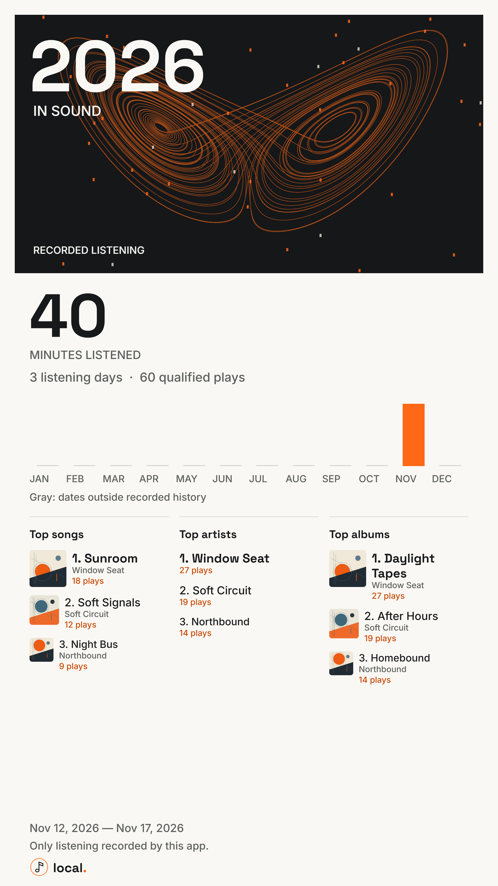
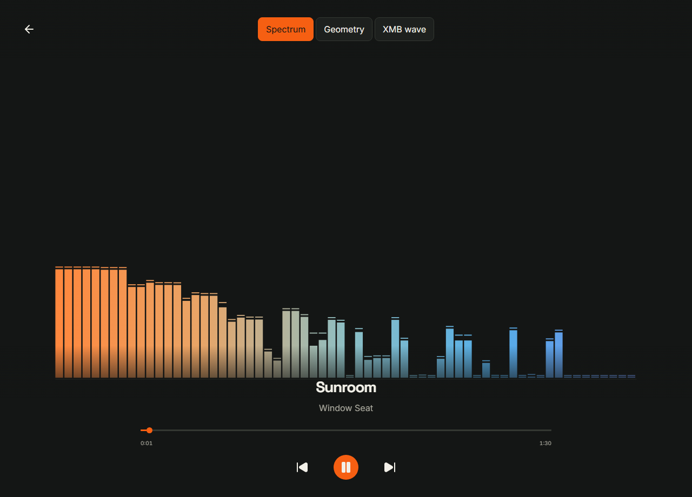
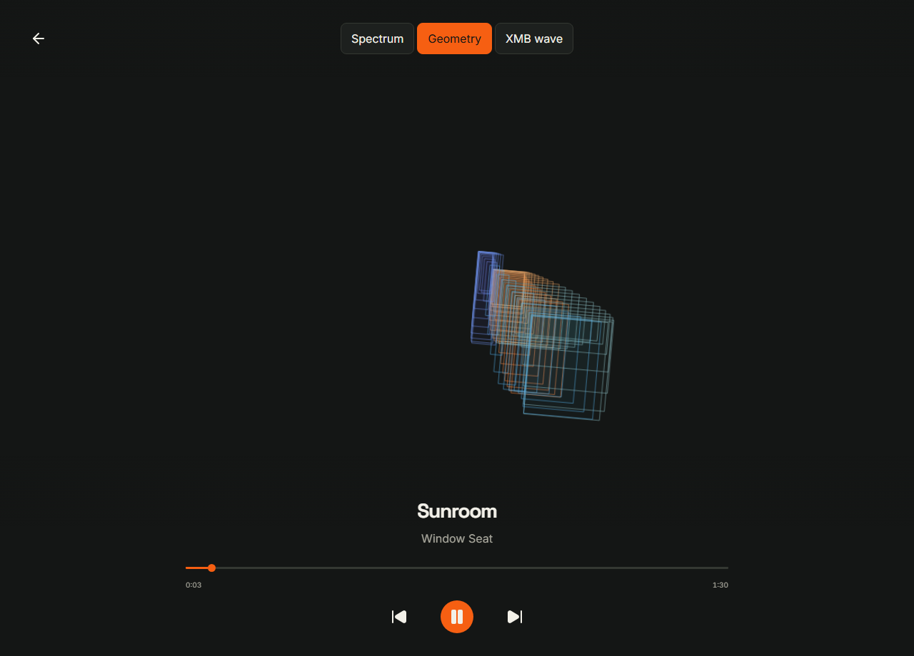
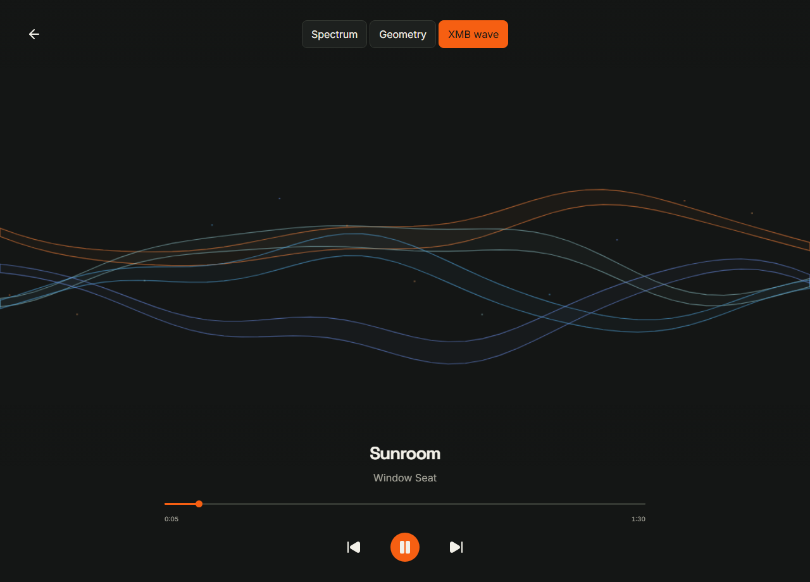
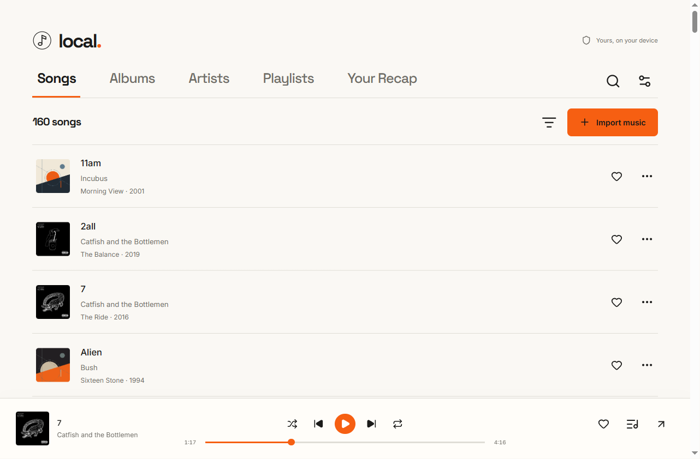
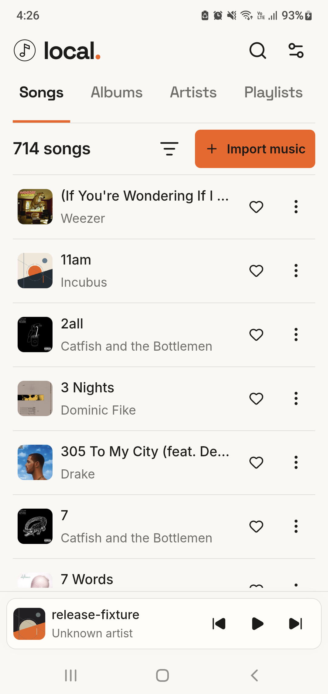
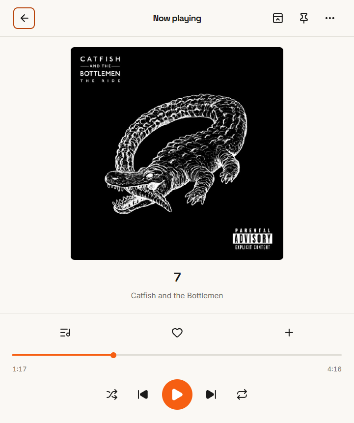
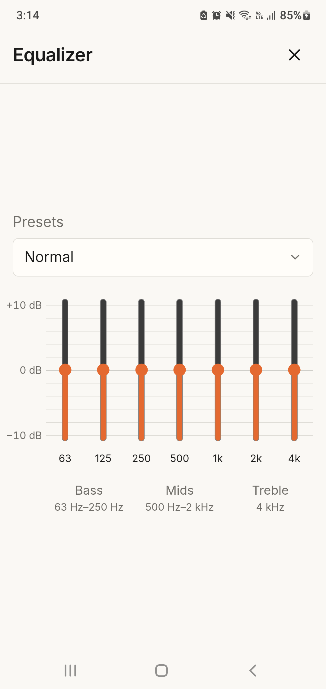

# Local Music

[](https://github.com/NotsoJharedtrollOx17/LocalMusic/actions/workflows/ci.yml)

**Your files. Your music. Your recap.**

[Take a look around the app →](https://notsojharedtrollox17.github.io/LocalMusic/)

I built Local Music for the music I already own—and because I missed players that made a local collection fun to explore. Give me a good library, a playlist worth revisiting, and some frequency bars dancing along. That's the idea here.

It's a personal project for **Android and Windows**: offline playback, playlists, an equalizer, three visualizers and a weekly, monthly or yearly **Your Recap**. A little Samsung Music in the phone flow, a little PSP XMB in the tabs, and plenty of orange. No account or streaming subscription. English and Spanish, with light, dark and system themes.

## A look around

### Your year in sound. Your songs in motion.

The songs that stayed with you deserve more than a play count. **Your Recap** turns your week, month or year into a little listening keepsake. **Spectrum, Geometry and XMB wave** bring some classic player energy back while the music runs.

<table>
  <tr><th>Your Recap · A listening keepsake</th><th>Spectrum · Turn it up, watch it move</th></tr>
  <tr>
    <td valign="top"></td>
    <td valign="top"></td>
  </tr>
</table>

These captures use the real browser preview with original sample audio and **illustrative listening data**, separate from personal history. Open an image for the full-size view, or [explore the landing page](https://notsojharedtrollox17.github.io/LocalMusic/) to see all three visualizer modes.

<details>
<summary>Two more moods: Geometry and XMB wave</summary>

<table>
  <tr><th>Geometry · Origin of Symmetry</th><th>XMB wave · Go with the flow</th></tr>
  <tr>
    <td></td>
    <td></td>
  </tr>
</table>

</details>

<details>
<summary>The native builds: Windows and Android</summary>

Windows on the left and Android on a Galaxy Note10+ on the right, captured during the native v1.0.0 checks.

<table>
  <tr>
    <th>Windows · Your library, room to breathe</th>
    <th>Android · Music within reach</th>
  </tr>
  <tr>
    <td valign="top"></td>
    <td valign="top"></td>
  </tr>
</table>

</details>

<details>
<summary>Take a closer look: Now Playing and Equalizer</summary>

<table>
  <tr>
    <th>Windows · A player of its own</th>
    <th>Android · Tune it your way</th>
  </tr>
  <tr>
    <td valign="top"></td>
    <td valign="top"></td>
  </tr>
</table>

The player can stay beside your library on Windows. On the phone, the mini-player stays close while you browse. Album artwork belongs to its respective owners; the Android mini-player shows original test audio used during release checks.

</details>

## Get the app

Grab a build from [GitHub Releases](https://github.com/NotsoJharedtrollOx17/LocalMusic/releases): a Windows x64 installer or portable ZIP, or the Android ARM64 APK. Compare your download with the release's SHA256SUMS.

Windows packages are unsigned and need WebView2; the installer may need connectivity to obtain it. Android requires Android 8/API 26 or later. These are direct downloads, not store listings.

**Coming from a debug build?** The production Android app uses a permanent release certificate, so it cannot update an earlier debug-signed installation in place. Back up and review your app data before switching to a clean installation. The [verification record](docs/verification.md) lists the builds and devices actually checked.

## What you can do

- **Find that one song.** Browse Songs, Albums and Artists, or search right inside the view you're using. Clean up collaboration credits, review duplicate songs and link equivalent albums while keeping your files and tags intact.
- **Make the next mix.** Build a playlist yourself, use the four automatic collections, or try Familiar, Balanced or Explore. Suggestions draw on your listening, metadata and available sound descriptors. “Suggest less” is reversible, and audio analysis runs only when you generate a mix, while playback is paused and the app is visible.
- **Bring back the visualizers.** Spectrum bars, the Origin of Symmetry geometry and XMB waves respond to the music. There's also a nine-band Equalizer with presets and a saved Custom setting. On Windows, the player, visualizer and equalizer can each have their own window.
- **See what stayed on repeat.** Your Recap covers the current week, month or year, with top songs, artists and albums, artwork and honest history coverage. Save the top ten as a playlist or export a Story/Feed PNG. Android 10+ supports Gallery saving and system sharing; you choose the destination.
- **Keep listening.** Edit the queue, mark favorites, shuffle, repeat and use the mini-player while browsing. Android supports background playback. On Windows, playback keeps advancing even without an audio output—and that time still counts toward your history.

Curious how the mixes or counts work? The [usage guide](docs/usage.md), [playlist methodology](docs/personalized-playlists.md) and [Recap rules](docs/recap-methodology.md) explain them. The recommendation system is an explainable local heuristic, not a mood-reading model.

## Your collection stays yours

Your music, metadata, feedback, sound descriptors and listening history stay on your device. Local Music doesn't upload your listening data or source audio. Recap images contain display names, artwork and calendar coverage; file paths, exact listening timestamps, device IDs and private sessions stay out of them. Sharing hands the image to the app you choose.

Deleting history clears its influence on suggestions and removes saved Recap snapshots. Your music, favorites, explicit suggestion preferences and sound descriptors remain. Library organization is reversible. Browser sample audio is original and excluded from Recap. The details are in [library and listening rules](docs/library-and-playback.md).

## Under the hood

React/TypeScript handles the interface, Rust owns the native library and listening rules, and Android Media3 handles background audio. The browser preview has its own IndexedDB/Web Audio adapter. It's useful for development; it isn't a substitute for testing the native app.

Want to work on it? Start with Node 24, Rust stable and the relevant native tools. Android CI uses JDK 21, SDK 36 and NDK 29.0.14206865. On PowerShell, use `npm.cmd`.

```powershell
npm.cmd ci
npm.cmd run dev
npm.cmd run check
python.exe scripts/check-docs.py
node.exe scripts/check-version.mjs
. ./scripts/env.ps1
npm.cmd run test:core
npx.cmd playwright install chromium
npm.cmd run test:browser
```

See [development/setup](docs/developer-guide.md), [testing](docs/testing.md) and [release/signing](docs/release-process.md). The [verification record](docs/verification.md) keeps passing builds, browser checks and actual device results separate. Sustained battery/thermal behavior and manual accessibility still need their own measurements.

New development starts from `dev` on a `dev.feature-name` branch. Reviewed changes return to `dev`; `main` contains reviewed release integrations and release tags. Read [AGENTS.md](AGENTS.md) before substantial changes. Keep build artifacts, personal profiles and signing material out of Git.

## Documentation

The [documentation index](docs/README.md) is the starting point for usage, architecture, methods and release instructions. Older plans remain in Git history, [release history](docs/releases/history.md) keeps the version trail, and the original reference material lives under `agents/`.

## AI-use acknowledgement

I used ChatGPT/Codex to help with planning, implementation, documentation and interpreting tests. I made the product decisions and reviewed the work. The [verification record](docs/verification.md) documents the actual build and device checks, including the manual testing still to do.

## Cite this software

```bibtex
@software{floresazcona2026localmusic,
  author  = {Flores Azcona, Abraham Jhared},
  title   = {Local Music},
  year    = {2026},
  version = {1.0.1},
  url     = {https://github.com/NotsoJharedtrollOx17/LocalMusic},
  license = {MIT}
}
```

Machine-readable citation metadata lives in [CITATION.cff](CITATION.cff). If you use Local Music in your work, please cite the version you used.

## License and credits

Copyright (c) 2026 **Abraham Jhared Flores Azcona**. Released under the [MIT license](LICENSE).

Fonts, libraries, artwork and the Origin of Symmetry adaptation have their credits in [third-party notices](docs/third-party-notices.md) and the bundled license files. Samsung Music, PSP XMB and classic visualizers helped shape the feel; this is an independent personal project, with no affiliation to Samsung, Sony or Apple.
